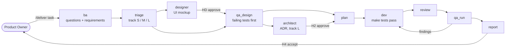

# Delivery module

**A "Product Owner → accepted change" pipeline for AI coding agents.**
You describe a task in plain words. A team of AI roles clarifies it, writes testable requirements, designs the tests first, implements the code, reviews it, runs QA and hands you an acceptance report. You only decide at a few checkpoints.

It runs on top of the agent CLIs you already use — [Claude Code](https://claude.com/claude-code), [Codex CLI](https://github.com/openai/codex) and Antigravity (`agy`) — and spreads the roles between them, so that the model that wrote the code is not the one that reviews and tests it.

- **No dependencies.** One Node.js 18+ script and a folder of Markdown role prompts.
- **Stack-independent.** Profiles for Yii2, Laravel, Symfony, Python and Node/TypeScript, a generic profile for everything else, and a separate track for an empty project.
- **Works with one tool or three.** Every role has a fallback queue; with a single tool the module still runs and marks reduced independence in the report.
- **Hard rules live in code, not in prompts.** JSON schemas for artifacts, forbidden paths, locked QA tests, detection of silent tool failures (`delivery.mjs`).

> **Status: early (v0.6.0).** Developed and tested on Windows. macOS/Linux should work but are not verified yet; the most likely differences are the `agy` permission rules. See [Limitations](#limitations).

## How it works



| Checkpoint | When | You decide |
|---|---|---|
| **H1** | Requirements are unclear | Answer the BA's questions (one batch) |
| **HD** | The task changes the UI | Approve or comment on the mockup |
| **H2** | Track L / new project | Confirm the architecture decision |
| **H3** | Migration, RBAC, new dependency, data deletion | Approve the risky step |
| **H4** | Always | Accept the report or send remarks |

The conductor (Claude Code or Codex) never writes product code; it only runs roles, validates their output and commits. Roles talk to each other through files in `.work/tasks/<ID>/`. Details: [docs/pipeline.md](docs/pipeline.md).

## Requirements

- Node.js 18+ and git.
- At least one agent CLI: `claude` (Claude Code), `codex`, or `agy` (Antigravity). Two or three are better because review and QA are then done by a different tool than dev.
- Docker only if your project's tests run in Docker.

## Quick start

Install into your project (the one you want to deliver changes in):

```bash
# 1. Get the module
git clone https://github.com/UncleTioma/agent_delivery_module.git

# 2. Copy a clean module into your project
node agent_delivery_module/.agents/delivery/delivery.mjs export /path/to/your/project

# 3. Install skills and a draft config, then self-check (must print "ok": true)
cd /path/to/your/project
node .agents/delivery/delivery.mjs install
node .agents/delivery/delivery.mjs selftest
```

Then open the project in **Claude Code** or **Codex** and run:

```text
/deliver Add an "export to CSV" button on the orders page
```

On the first run the conductor does the setup with you: it asks, in one batch, what could not be detected (language, test command, Docker, publishing), checks your tools (`doctor`), proposes which tool runs which role and shows the permissions it needs. You confirm once; the pipeline starts.

Commit `.agents/` and `.claude/skills/` so the team shares the same setup (`.work/` is git-ignored automatically).

More commands:

```text
/deliver resume <ID>      continue an interrupted task
/deliver status [ID]      where the task is
/deliver-review           run a single role on its own (also -ba, -plan, -dev, ...)
```

No Node.js? Ask your agent: "install the delivery module following `.agents/delivery/INSTALL.md`".

## Default role map

| Role | Tool | Why |
|---|---|---|
| `ba`, `teamlead`, `report` | claude | Dialogue with the product owner, coordination |
| `architect`, `review`, `qa_design`, `qa_run` | antigravity | Large context; independent from dev |
| `dev` | codex | Implements and fixes code |
| `designer` | claude | Visual work; the only tool with the Artifact tool |

If a tool is missing, `doctor` picks the next one from the role's queue. You can restrict the set with `"tools_enabled": ["claude", "codex"]` in `project.json`. Full rules: [module README](.agents/delivery/README.md#default-role-map).

## CLI

```bash
node .agents/delivery/delivery.mjs <command>
```

| Command | Purpose |
|---|---|
| `install [--check]` | Create skills, update `.gitignore`, draft `project.json` |
| `detect` / `config` / `init-config` | Stack detection, config validation, regenerate the draft |
| `doctor [--probe] [--apply]` | Check tools, propose and confirm the role map |
| `perms [--apply]` | Show / write the tool permission rules (asks first) |
| `check-output <log>` | Catch silent tool failures (exit code 0, nothing done) |
| `validate`, `lock-tests`, `guard` | Artifact schemas, locked QA tests, forbidden paths |
| `export`, `upgrade`, `migrate-config` | Move the module between projects and versions |
| `selftest` | 147 checks on fixtures, spends no tokens |

The complete reference and every `project.json` option are in the [module README](.agents/delivery/README.md).

## Safety model

- The pipeline works on a **branch** (or worktree) named `ai/<ID>-<slug>`. It never merges and never pushes to your base branch; with `publish: true` it pushes the task branch and opens a draft merge request.
- QA tests are **locked by hash** before implementation; `guard` fails the run if dev edits them or touches `forbidden_paths` (`.env`, keys, ...).
- Tool permissions are written only by `perms --apply` after you confirm. For Antigravity the module uses a per-project profile with a terminal sandbox and denies dangerous system commands; it does not touch your global agent settings.
- Roles are told never to read secrets or touch the application database.
- Agents can still make mistakes. Review the branch before merging.

## Repository layout

```
.agents/delivery/     the module (this is what `export` copies)
  delivery.mjs, lib/    CLI and helpers
  roles/                prompts of all roles (ba, triage, designer, architect, plan, ...)
  profiles/             per-stack defaults
  schemas/, templates/  artifact formats
.agents/skills/       generated skill entry points for Codex / Antigravity
.claude/skills/       generated skill entry points for Claude Code
docs/pipeline.md      how the process works in detail
```

The `skills/` folders are generated by `install` — do not edit them by hand.

## Limitations

- The conductor is a model, not a program: it can misread an instruction. The hard rules are enforced by the CLI, but the flow itself is prompt-driven.
- Verified on Windows only. A full `/deliver` run on an empty folder and on other stacks is still to be done.
- Antigravity (`agy`) options such as `--app_data_dir` are undocumented in `agy --help`; they were verified on agy 1.4.x.
- With one tool only, review/QA independence is weak. The report says so.

## Contributing

See [CONTRIBUTING.md](CONTRIBUTING.md). Run `node .agents/delivery/delivery.mjs selftest` before sending a change.

## License

[MIT](LICENSE)
